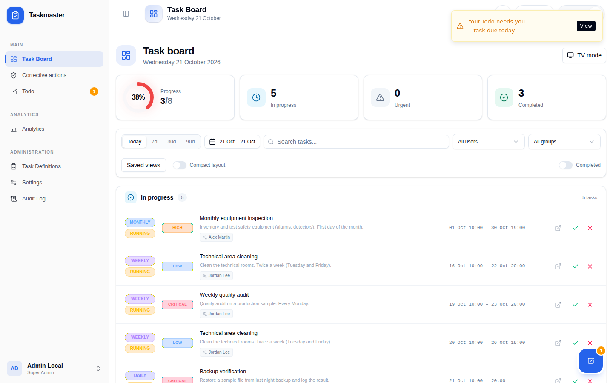
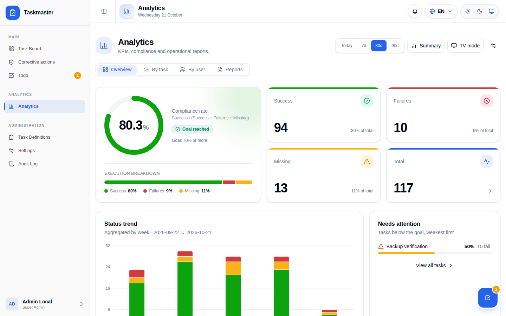
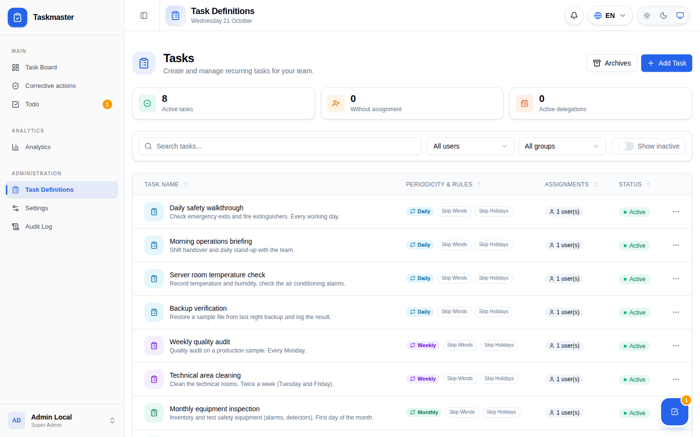
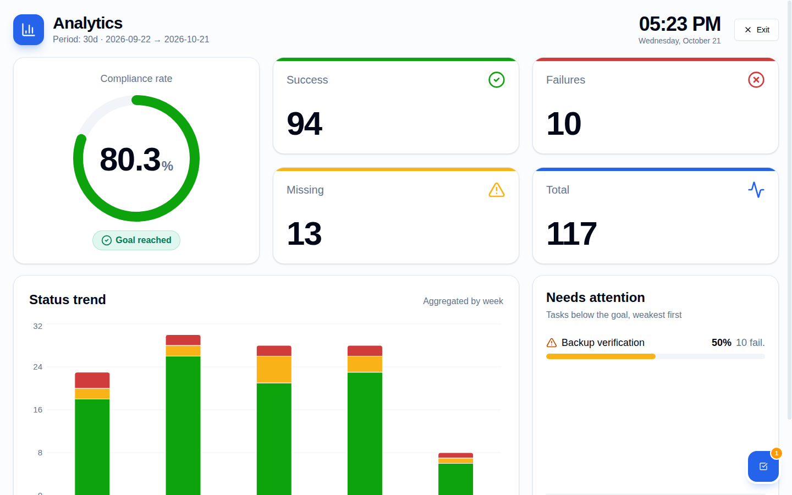
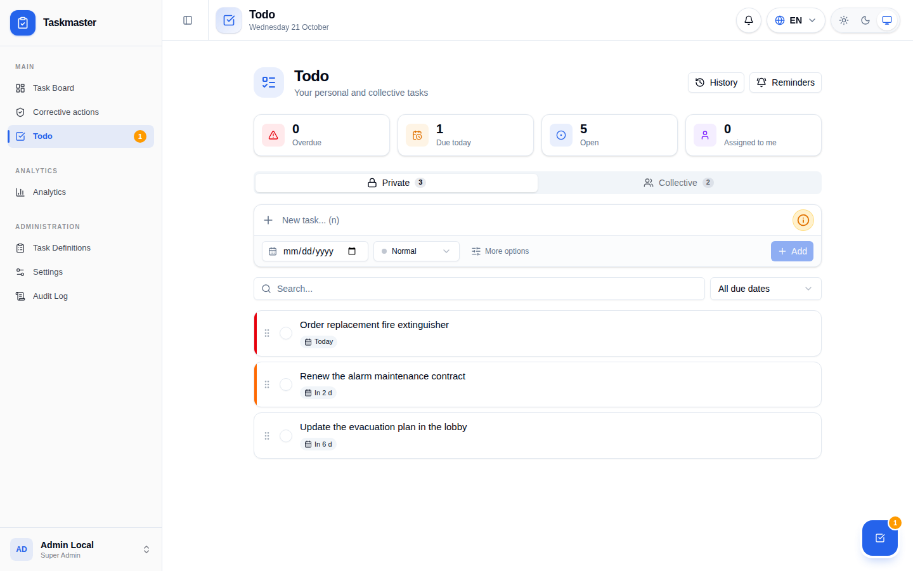
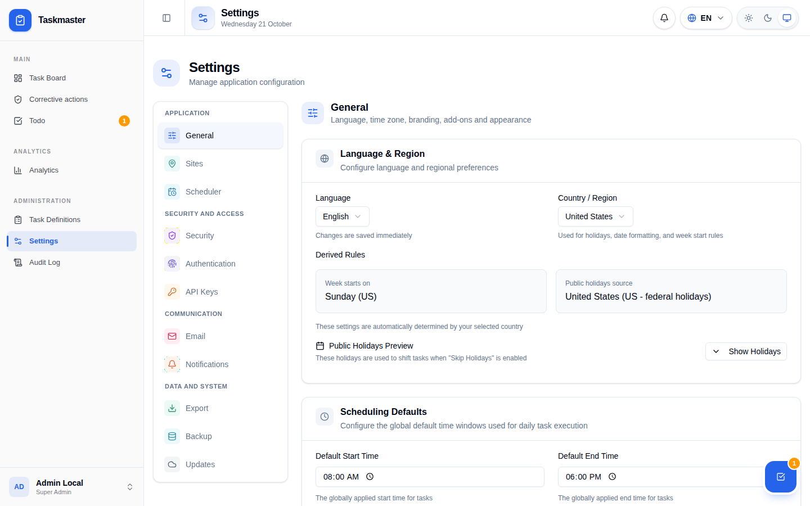
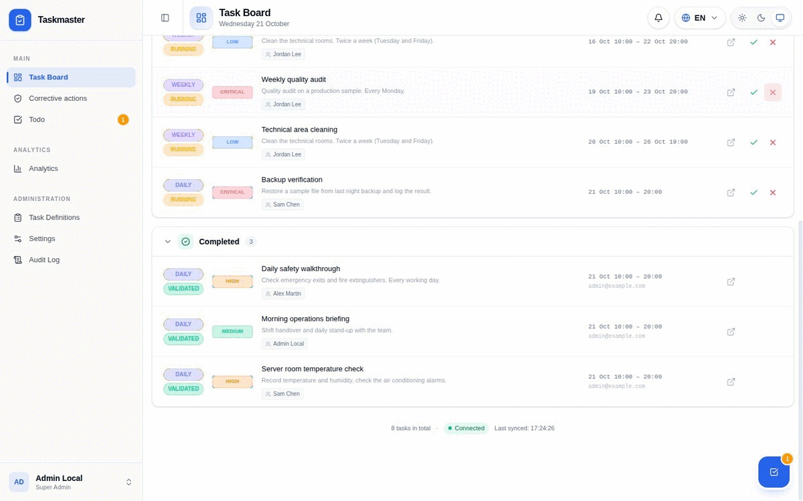

<div align="center">


# Taskmaster

**Plan, validate and prove your recurring operational tasks.**

Safety walkthroughs, technical checks, quality audits, compliance reviews: define them once, Taskmaster schedules every occurrence, your team validates them on a live board, and you get the history and the compliance figures.

[](https://github.com/mikaYX/taskmaster/releases)
[](https://hub.docker.com/r/mikaxy/taskmaster)
[](https://github.com/mikaYX/taskmaster/actions/workflows/quality.yml)
[](LICENSE)

[Getting started](docs/getting-started.md) · [Documentation](docs/README.md) · [Changelog](CHANGELOG.md)

<br>


</div>

## Why Taskmaster

Most task tools are built for projects. Taskmaster is built for **recurring work that must be done and proven**, every day, week, month or year:

- **Define once, run forever.** Occurrences are generated from the schedule, with weekends, holidays and time windows taken into account.
- **One board for the whole team.** Everyone sees what is due now, validates it in one click or reports a problem, on a desk or on a wall screen.
- **Traceable by design.** Checklists, photo evidence, corrective actions and an audit log keep the record auditors ask for.

## Features

| | |
| --- | --- |
| **Operations** | Live task board with filters and saved views · TV mode and read-only guest screens · execution checklists with photo evidence · corrective actions · delegations · personal and collective Todo lists |
| **Scheduling** | Daily, weekly, monthly, yearly or custom (RRULE) · skip weekends and public holidays by country · time windows and time zones · recurrence from the last completion |
| **Analytics** | Compliance rate against a goal · trends by day or week · rankings by task and by user · CSV and PDF reports · full-screen TV layout |
| **Organization** | Multiple sites with a hierarchy · groups · roles: Super Admin, Manager, User, Guest · audit log |
| **Sign-in and security** | Local accounts, LDAP / Active Directory, Azure AD / Entra ID, Google Workspace, OIDC, SAML 2.0 · TOTP MFA and passkeys · API keys with scopes · encrypted settings and backups |
| **Notifications** | Email (SMTP, SendGrid, Mailgun, Mailjet), Slack, Microsoft Teams, Telegram and web push, on failure, missed task or as a reminder |
| **Operations-ready** | Single Docker image or Windows MSI · scheduled, encrypted backups with restore · health check, Prometheus metrics, OpenTelemetry · English and French |

## Screenshots

<table>
  <tr>
    <td width="50%">
      <picture>
        <source media="(prefers-color-scheme: dark)" srcset="docs/screenshots/board-dark.png">
        
      </picture>
      <p align="center"><b>Task board</b>: today's tasks, progress and filters</p>
    </td>
    <td width="50%">
      <picture>
        <source media="(prefers-color-scheme: dark)" srcset="docs/screenshots/analytics-dark.png">
        
      </picture>
      <p align="center"><b>Analytics</b>: compliance, trends and tasks needing attention</p>
    </td>
  </tr>
  <tr>
    <td width="50%">
      <picture>
        <source media="(prefers-color-scheme: dark)" srcset="docs/screenshots/task-definitions-dark.png">
        
      </picture>
      <p align="center"><b>Task definitions</b>: schedules, rules and assignments</p>
    </td>
    <td width="50%">
      <picture>
        <source media="(prefers-color-scheme: dark)" srcset="docs/screenshots/analytics-tv-dark.png">
        
      </picture>
      <p align="center"><b>TV mode</b>: a wall screen for the control room</p>
    </td>
  </tr>
  <tr>
    <td width="50%">
      <picture>
        <source media="(prefers-color-scheme: dark)" srcset="docs/screenshots/todos-dark.png">
        
      </picture>
      <p align="center"><b>Todo</b>: private and collective lists</p>
    </td>
    <td width="50%">
      <picture>
        <source media="(prefers-color-scheme: dark)" srcset="docs/screenshots/settings-dark.png">
        
      </picture>
      <p align="center"><b>Settings</b>: sign-in, notifications, backups and more</p>
    </td>
  </tr>
</table>

<details>
<summary><b>Create a task in five steps</b></summary>
<br>

</details>

<details>
<summary><b>First launch: the setup wizard</b></summary>
<br>

</details>

## Quick start

With Docker:

```bash
curl -O https://raw.githubusercontent.com/mikaYX/taskmaster/main/docker-compose.yml
curl -o .env https://raw.githubusercontent.com/mikaYX/taskmaster/main/.env.docker.example
# Edit .env: set POSTGRES_PASSWORD, AUTH_SECRET, BOOTSTRAP_SECRET and BACKUP_ENCRYPTION_KEY
docker compose up -d
```

Open `http://localhost:3000` and create the first administrator in the setup wizard.

Running from source, on Windows Server without Docker, or behind a reverse proxy: see [Getting started](docs/getting-started.md).

## Documentation

| | |
| --- | --- |
| [Getting started](docs/getting-started.md) | Docker, development setup, first login |
| [User guide](docs/user-guide.md) | Day-to-day use |
| [Use cases](docs/use-cases.md) | Example schedules |
| [Configuration](docs/configuration.md) | Environment variables |
| [Authentication](docs/authentication.md) | SSO, MFA, passkeys, roles |
| [API keys](docs/api-keys.md) | Integrations and webhook |
| [Operations](docs/operations.md) | Backups, monitoring, privacy |
| [Version updates](docs/version-updates.md) | Updating an installation |
| [Troubleshooting](docs/troubleshooting.md) | Common problems |
| [Windows Server](docs/windows-server-2019-local.md) | MSI installation |

## Tech stack

| Layer | Technology |
| --- | --- |
| Frontend | React 19, Vite, Tailwind CSS 4, shadcn/ui, TanStack Query, Zustand |
| Backend | NestJS 11, Prisma, PostgreSQL 18, Redis, BullMQ |
| Auth | Passport, JWT in HttpOnly cookies, LDAP, OIDC, SAML, WebAuthn |
| Observability | Pino, Prometheus, OpenTelemetry |
| Delivery | Single Docker image (API + web app), Windows MSI |

TypeScript end to end, in an npm workspaces monorepo.

## Contributing

Contributions are welcome: features, fixes, translations, documentation and tests. Read [CONTRIBUTING.md](CONTRIBUTING.md) to get set up, and open an issue to discuss a larger change first. Security issues go through [SECURITY.md](SECURITY.md), never a public issue.

## Roadmap

- Outgoing webhooks (an incoming webhook already exists, see [API keys](docs/api-keys.md))
- An installable mobile app (PWA)
- More interface languages

## Support the project

If Taskmaster is useful to you, you can support its development:

<a href="https://buymeacoffee.com/mikaxy" target="_blank"></a>

## License

[MIT](LICENSE)
